# Recovering Data from a Corrupted EC2 Instance (Ubuntu and Windows)

A hands-on AWS project that shows how to get data back from an EC2 instance that is corrupted or unusable. The instance's disk (an EBS volume) is detached, attached to a healthy **recovery instance**, and the data is copied out. I did this twice: once for an **Ubuntu (Linux)** instance and once for a **Windows Server** instance.

## Why this works

An EC2 instance's data lives on its EBS volume, not on the instance itself. Even when the operating system will not boot, the volume is usually intact. Attaching it to a working instance as a second disk gives full access to its files.

```
 Corrupted instance             Recovery instance (healthy)
 ------------------             ---------------------------
 1. Stop instance
 2. Detach root volume  ----->  3. Attach as a secondary disk
                                4. Mount / bring the disk online
                                5. Copy the data out
                                6. Unmount, detach, clean up
```

## Environment

| Item | Ubuntu scenario | Windows scenario |
|------|-----------------|------------------|
| Corrupted instance | Ubuntu, stopped | Windows Server, stopped |
| Recovery instance | Ubuntu, running | Windows Server, running |
| Instance type | t3.small | t3.small |
| Volume size | 15 GiB | 35 GiB |
| Region / AZ | ap-southeast-2 / ap-southeast-2b | ap-southeast-2 / ap-southeast-2b |
| Access method | SSH (MobaXterm) | Remote Desktop (RDP) |
| Test data | `Backups`, `Config_Files`, `Imp_Data` in `/home/ubuntu` | `Backups`, `Configuration_File`, `Imp_Data` on `C:\` |

**Tools:** Amazon EC2, Amazon EBS, `lsblk`, `mount`, `rsync`, Windows Disk Management, File Explorer.

> The volume and the recovery instance must be in the **same Availability Zone**.

---

## Part 1: Recovering data from an Ubuntu instance

### Step 1: Create the test data on the corrupted instance
I created three directories in `/home/ubuntu` to act as the important data I want to recover.

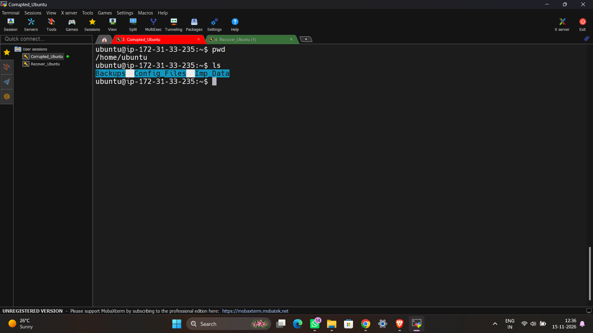

### Step 2: Detach the volume and attach it to the recovery instance
I stopped the corrupted instance, detached its volume, and attached that volume to the healthy Ubuntu recovery instance as a secondary disk.

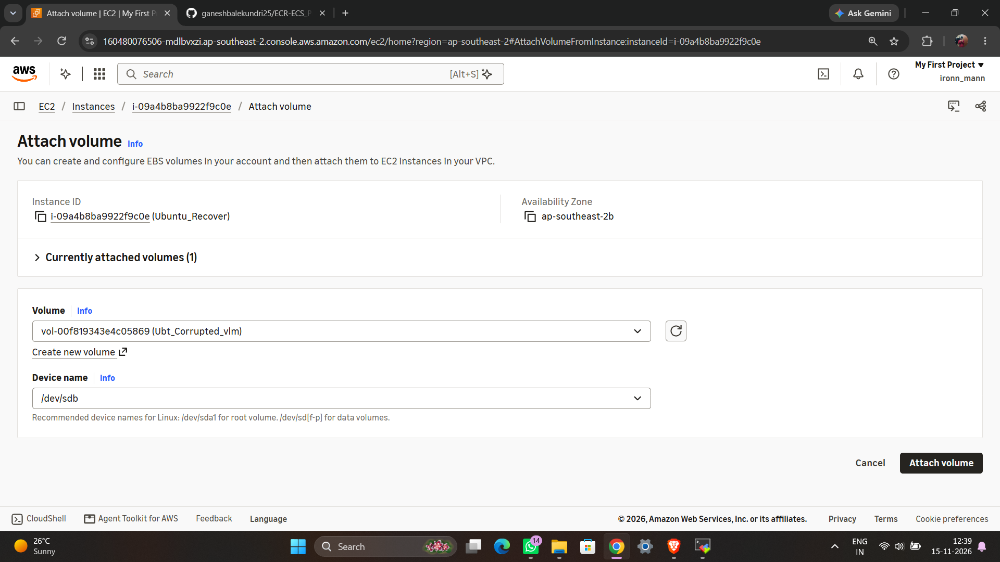

The volume now shows as attached in the recovery instance's block devices.

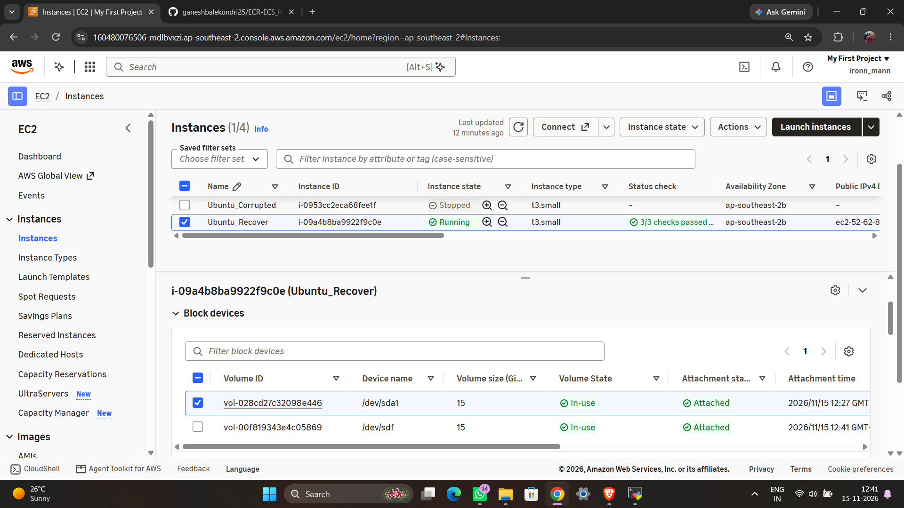

### Step 3: Find the disk, mount it and browse the data
On the recovery instance, `lsblk` shows the new disk as `nvme1n1`, with its main partition `nvme1n1p1`. I mounted that partition **read-only** so the corrupted volume could not be changed while I worked, then listed the old filesystem.

```bash
lsblk
sudo mkdir -p /mnt/recovery
sudo mount -o ro /dev/nvme1n1p1 /mnt/recovery
ls /mnt/recovery
```

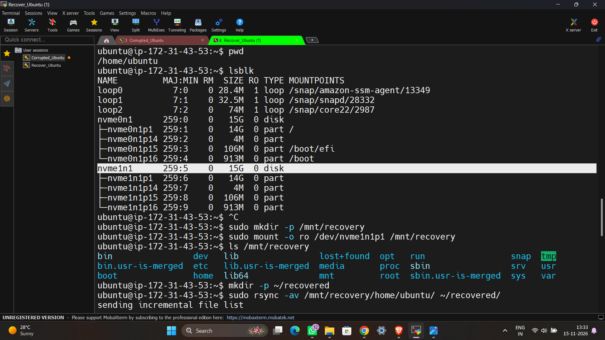

### Step 4: Copy the data to the recovery instance
The old instance's home directory is at `/mnt/recovery/home/ubuntu`. I copied it with `rsync`.

```bash
mkdir -p ~/recovered
sudo rsync -av /mnt/recovery/home/ubuntu/ ~/recovered/
```

The output shows `Backups/`, `Config_Files/` and `Imp_Data/` being recovered.

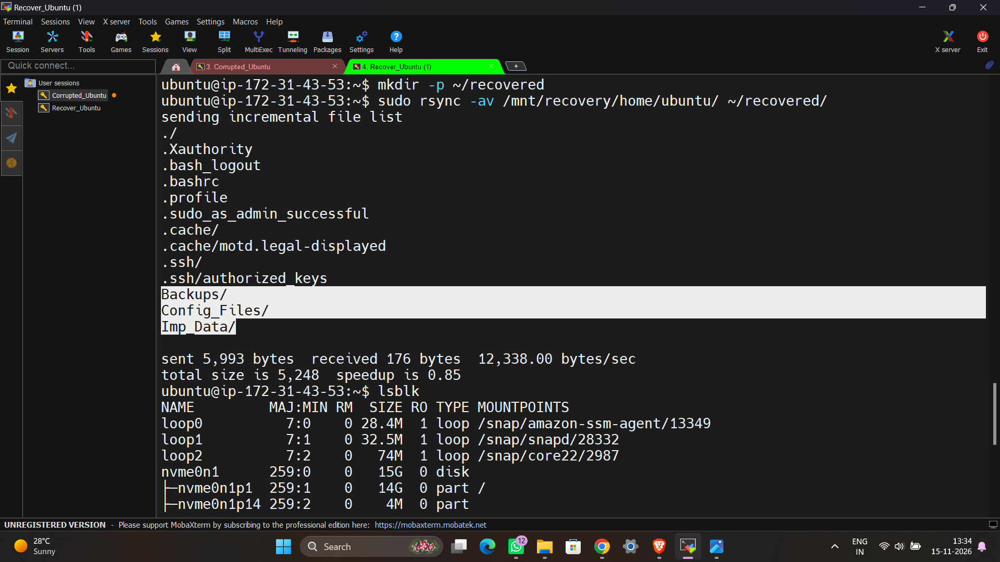

### Step 5: Clean up
```bash
sudo umount /mnt/recovery
```
Then detach the volume in the EC2 console.

---

## Part 2: Recovering data from a Windows instance

### Step 1: Create the test data on the corrupted instance
On the Windows instance, I created three folders on the `C:` drive: `Backups`, `Configuration_File` and `Imp_Data`.

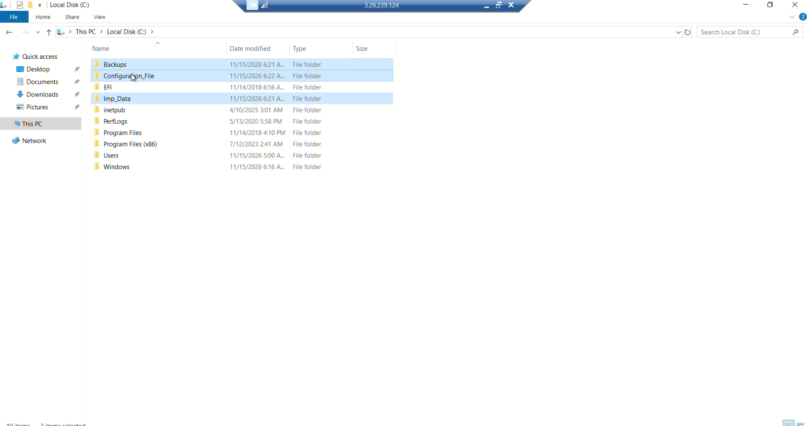

### Step 2: Detach the volume and attach it to the recovery instance
I stopped the corrupted Windows instance (it shows as **Stopped**) and kept the recovery instance running.

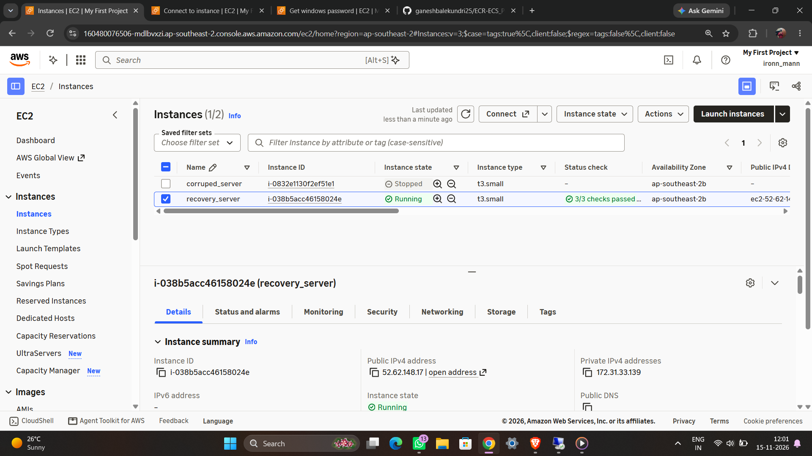

I then attached the corrupted volume to the recovery instance as a secondary data volume.

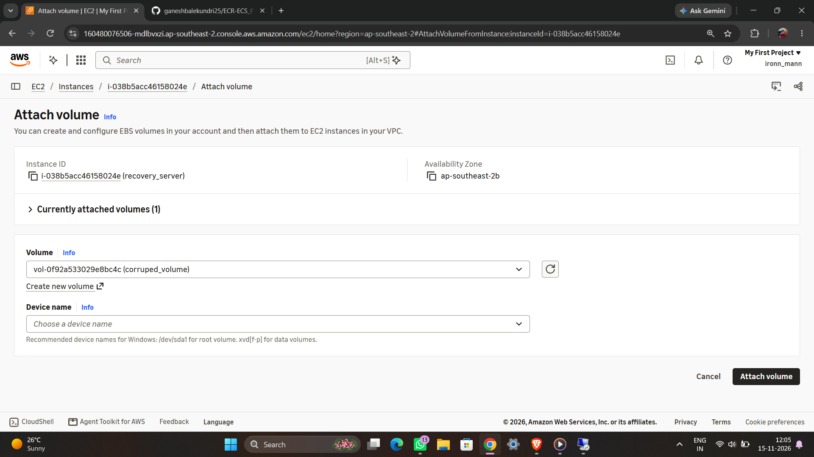

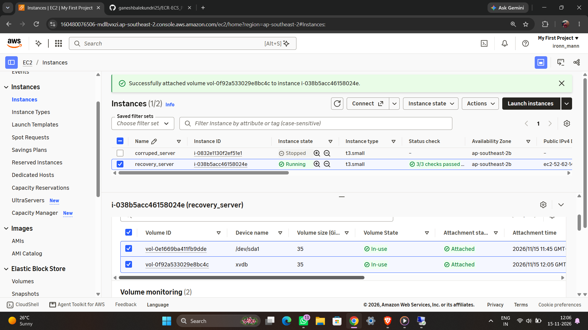

### Step 3: Bring the disk online
I connected to the recovery instance over RDP and opened **Disk Management**. The new disk appeared as **Disk 1** and was **Offline**, because Windows does not bring an attached data disk online on its own.


I right-clicked Disk 1 and chose **Online**. Windows then assigned it the drive letter **D:** and showed the old NTFS volume as healthy.

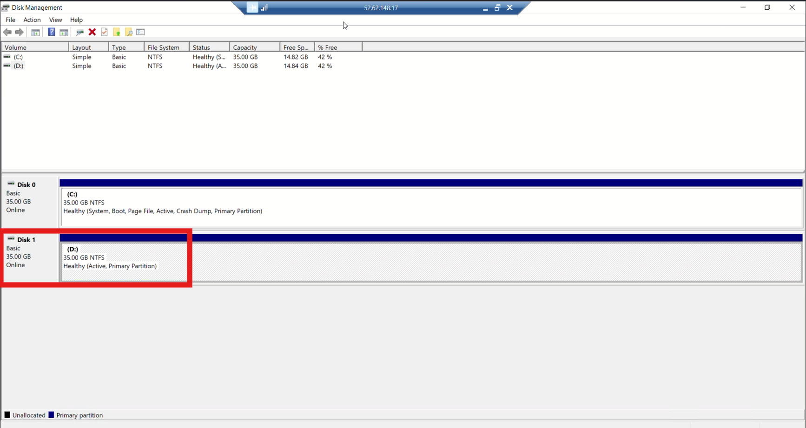

### Step 4: Access the recovered data
The corrupted volume now appears as **Local Disk (D:)** in File Explorer.

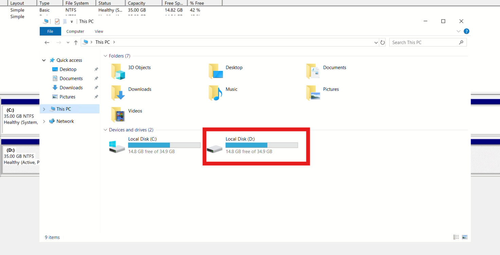

Opening `D:` shows the folders I created on the corrupted instance (`Backups`, `Configuration_File` and `Imp_Data`) next to the old Windows system folders. These can be copied to a safe location.

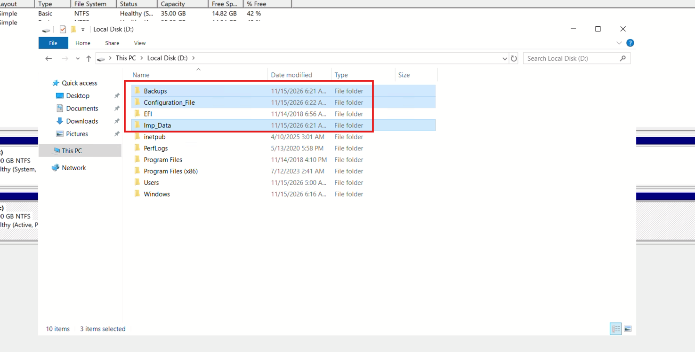

---

## Ubuntu vs Windows at a glance

| | Ubuntu (Linux) | Windows |
|---|---|---|
| Connect with | SSH | RDP |
| How the disk shows up | `nvme1n1` in `lsblk` | Disk 1 in Disk Management |
| Needs an extra step? | Mount the partition at `/mnt/recovery` | Set the disk **Online** |
| Where the data appears | `/mnt/recovery/home/ubuntu` | `D:\` |
| Copy method | `rsync` or `cp` | Copy and paste in File Explorer |
| Clean up | `umount`, then detach | Set the disk offline, then detach |

## Key learnings

- Data on a broken instance can usually be recovered because it lives on a separate EBS volume.
- A recovery instance must be in the same Availability Zone as the volume.
- On Linux, a new disk must be **mounted** before use. On Windows it must be set **online**.
- Mounting read-only protects the original data while you work.
- Never mount or attach a second root volume as the boot disk of the recovery instance.

## Good practices

- Take an EBS **snapshot** of the corrupted volume before touching it.
- Mount the volume read-only first. Run `fsck` only if it will not mount, because it modifies the disk.
- Copy important data off the recovery instance (for example to S3) before you delete anything.
- Delete the recovery instance, extra volumes and snapshots when you finish to avoid charges.

## Author

**Ganesh Balekundri** - (AWS, DevOps)
GitHub: [@ganeshbalekundri25](https://github.com/ganeshbalekundri25)
